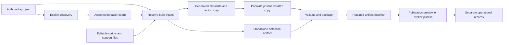

# Implementation plan: application configuration consolidation

**Status:** Implemented and independently reviewed. Offline validation passed in Windows PowerShell 5.1 and PowerShell 7, with two explicitly skipped link-fixture checks per runtime. See the [current evidence](../evidence/configuration-v3-validation.md). The tasks below retain the agreed scope and acceptance criteria.

The intended result is one authored application definition per variant, with editable PowerShell action scripts. A build-time resolver will generate PSADT metadata, bind standalone detection to the accepted release, and supply consistent packaging/publication settings. Engineers will stop maintaining parallel recipe and metadata values or duplicate installer arguments.

This is a configuration and build-interface refactor. It does not deliver a production lifecycle service or authorize installer execution or tenant operations.

## 1. Scope and decisions

| Decision | Planned behavior |
|---|---|
| Authored definition | Use `examples/apps/<application>/app.json`, with a version 3 schema. Retain stable application IDs. |
| Application commands | Keep arguments, installed executable paths and application-specific steps exclusively in editable `Install.ps1`, `Uninstall.ps1` and `Repair.ps1` sources. |
| Action mapping | Move the existing Install/Uninstall/Repair Pre/Main/Post references into `app.json`. Each operation retains required Main and optional Pre/Post. |
| Metadata generation | Generate `metadata.json` and `actions.json` as internal build inputs for the existing adapter. They cease to be manually maintained application configuration. |
| Template adapter | Preserve the current low-level adapter interface, exact upstream inventory checks, permitted edit checks and source-path protections. |
| Process handling | Author the process list once and map it to native `AppProcessesToClose`. Do not introduce custom endpoint process detection. |
| Release version | Resolve once into a separate accepted release record. Use that record for PSADT metadata, detection binding and publication. |
| Supported profile | Initially preserve the current examples: Windows 11 x64, SYSTEM, Auto, PSADT 4.1.8 and the inspected dependency pins. Unsupported options fail explicitly. |
| Publication | Retain separate preview and explicit execution paths; publish unassigned. Assignment remains a separate operation. |
| Runtime records | Keep tenant IDs, app/content IDs, assignments, observations and approvals outside immutable build artifacts. Never put credentials in application definitions. |

The existing native-v2 examples omit the stock completion prompt through an explicit adapter option. Preserve that behavior as a named compatibility profile in this migration. The adapter's default still retains the prompt. Changing this behavior or adopting a stricter framework-preservation profile is a separate change; do not describe native-v2 as satisfying that stricter profile.

Broader native-function validation, new deployment profiles, toolkit upgrades, automatic downloading, unattended approvals, scheduling, CI/CD infrastructure, resumable publication and automatic assignment are outside this implementation. Editable scripts remain subject to the existing validator's restrictions until a separately scoped extension is implemented.

## 2. Current implementation evidence

| Finding | Current source | Consequence |
|---|---|---|
| Recipe arguments duplicate executable action content | [Archived Firefox recipe](../tests/fixtures/legacy-v2/recipes/firefox.json), [Install.ps1](../examples/apps/firefox/Install.ps1), [Uninstall.ps1](../examples/apps/firefox/Uninstall.ps1) | Remove command arguments and installed uninstaller paths from the new definition. |
| Adapter reads metadata and action files, without reading recipes | [Populate-PSADTTemplate.ps1](../scripts/Populate-PSADTTemplate.ps1) | Introduce a build-side resolver instead of adding Evergreen or publication logic to PSADT. |
| Discovery accepts schema version 2 | [Discovery example](../examples/Discover-Application.example.ps1) | Add an explicit version 3 contract; avoid guessing which input format was supplied. |
| Installer staging uses the recipe's setup filename | [Release preparation](Prepare-release.md) | Retain an explicit payload destination when removing the install command block. |
| Detection contains a frozen minimum-version literal | [Archived Firefox detection](../tests/fixtures/legacy-v2/apps/firefox/Detect.ps1), [Archived Notepad++ detection](../tests/fixtures/legacy-v2/apps/notepadplusplus/Detect.ps1) | Add controlled build-time binding without changing installed-product detection logic. |
| Packaging and publication independently declare effective settings | [Packaging example](../examples/Package-Application.example.ps1), [Publication example](../examples/Publish-Unassigned.example.ps1) | Wire both to resolved inputs; merging JSON alone does not fix this. |
| Existing example assertions depend on v2 inputs and historical detection hashes | [Example contract test](../tests/Test-NativeExampleContract.ps1) | Separate legacy evidence from new contract checks; do not rewrite historical results. |

These links describe the pre-migration implementation. Preserve this distinction when updating operational documentation.

## 3. Configuration ownership

The schema must define one authored owner for each concept. Similar names do not imply identical meanings.

| Concept | Canonical input and mapping |
|---|---|
| Product identity | Keep stable ID, publisher and product name in `app.json`; map publisher/name to `AppVendor`/`AppName`. Preserve a distinct portal display name. |
| Variant | Define architecture, language, channel, edition and installer type once as product characteristics. Use explicit translations for provider selection and toolkit tokens where vocabularies differ. |
| Versions | Keep vendor application version, recipe revision, package revision and deployment-script version distinct. Freeze the authored script date; do not insert the current time into generated script metadata. |
| Native processes | One process array maps to `AppProcessesToClose`; the recipe does not implement closure behavior. |
| Exit codes | Document PSADT success/reboot handling and Intune result classification as separate, compatible semantics. Reject duplicate or contradictory entries. |
| Execution | Validate SYSTEM context and administrative requirements together while preserving their different meanings. |
| Payloads | Declare stable destinations such as `Files/Firefox.msi`, associated installer identity and permitted support-file destinations. Action scripts reference this file interface. |
| Configuration | Declare supporting files and their staging destinations; executable configuration changes remain in action scripts. |
| Detection | Reference editable standalone detection source and a supported version-binding rule. Preserve application-specific version normalization. |
| Repair and external policy | Retain capability/prerequisite declarations. They describe requirements and do not prove script behavior or external policy compliance. |
| Launch commands | Derive Intune Install/Uninstall launcher commands from the supported deployment profile; do not require manually repeated command strings. |

Do not extract command configuration by reverse-engineering arbitrary PowerShell. Build-time parsing validates syntax and supported binding locations; it does not execute snippets or infer all possible runtime commands. Do not use `Invoke-Expression` or add an endpoint recipe loader.

## 4. Intended flow and interfaces

Working directories and artifacts belong on nonsynchronized local storage. The source repository may remain in its current location.

| Interface | Inputs | Output and boundary |
|---|---|---|
| Discover | Validated app definition and pinned Evergreen inputs | Candidate discovery record. This operation may access vendor services; its result is not installer approval. |
| Resolve | App definition, candidate/accepted release data, reviewed local installer and validation evidence | Frozen effective inputs. Preview validates local inputs without writes or network access; explicit local build prepares a fresh working directory. |
| Populate | Pristine template, generated metadata/action map, staged reviewed snippets | Fresh deployment copy and existing adapter integrity results. Never executes application code. |
| Bind detection | Standalone source, accepted normalized version, explicit binding contract | Standalone detection artifact plus source/output hashes. It must run without PSADT, recipes or release records on the endpoint. |
| Package | Validated generated source, accepted manifest and pinned packaging tool | Preview or explicit local packaging result. Packaging success is separate from endpoint acceptance. |
| Prepare publication | Final package/detection hashes, effective settings and separate acceptance evidence | Frozen publication request; does not re-discover or regenerate a package. |
| Publish | Frozen request, separately supplied tenant/authentication inputs | Preview or explicitly requested unassigned publication. Existing reconciliation limitations remain. |

Candidate discovery, locally validated preparation, endpoint acceptance and publication readiness must have different statuses. Synthetic test fixtures may exercise the first interfaces but cannot be marked ready for live publication.

The release contract must bind application ID, variant, source provenance, raw/normalized version and installer hash. Use a discovery fingerprint over provider pins and selection/variant intent, a separate build-input identity, and a publication/targeting configuration revision. Retain full definition hashes for provenance without making every metadata or target edit require rediscovery. Build must revalidate the current download/signature policy against retained installer bytes and evidence. Do not rewrite the authored discovery policy into a pinned version after discovery; the immutable release record locks the selected version.

At the resolution boundary, hash every referenced source. Before and after staging, compare the copied content with that reviewed snapshot; fail on drift rather than mixing inputs from different edits. Apply containment, file-type, redirected-path and destination-collision checks to action, detection and support sources as well as payloads.

## 5. Dependency-ordered work

Each task includes its own checks. The implementation now supplies these interfaces; follow the [walkthrough](Getting-started.md) and [configuration reference](Configuration-reference.md) for exact commands and field names.

### Task 1 — Define the version 3 contracts

**Dependencies:** None. **Scope:** Medium; schemas and contract documentation.

Define the consolidated application schema, resolved-release/effective-build shapes, field ownership, supported profile and errors. Include an explicit schema version and prohibit unknown/obsolete command fields or unrestricted metadata overrides that repeat canonical values. Specify which explicit local step performs full draft 2020-12 schema validation using a compatible validator, while keeping orchestration and semantic validation compatible with Windows PowerShell 5.1. No unsupported runtime may silently skip schema validation.

**Likely files:** New version 3 application schema; release/build contract schemas; a configuration reference.

**Acceptance and verification:**

- Valid Firefox and Notepad++ fixture definitions express one value per concept, including process handling and payload names.
- Unknown fields, legacy command strings, missing actions and unsupported profiles are rejected with the field and reason identified.
- A written consumption map states which operation uses every supported field; descriptive prerequisite fields are explicitly labeled.

### Task 2 — Resolve a local Firefox release without side effects

**Dependencies:** Task 1. **Scope:** Medium; resolver, discovery compatibility and focused tests.

Add a resolver that accepts the version 3 definition and explicit local release/installer evidence. Adapt discovery through a version-aware reader while the migration is staged. Do not turn ordinary resolution or preview into discovery, download, authentication or execution. Validate supported metadata, payload identity, approval state and required hashes before preparing outputs.

**Likely files:** New resolver and application-definition reader; discovery example; resolver tests.

**Acceptance and verification:**

- An offline Firefox fixture resolves consistent PSADT metadata, native processes, action references and effective publication settings.
- Wrong application/variant/version, changed installer bytes, incomplete required evidence and conflicting profile settings fail; preview creates no files and executes no snippets.
- Candidate-only fixtures cannot claim publish readiness; no source definition or historical release is rewritten.

**Checkpoint:** Review contract and resolver behavior before expanding consumers. Run PS5.1 and PS7 tests separately; validate schemas using the documented compatible validator.

### Task 3 — Generate a deployment while preserving editable sources

**Dependencies:** Task 2. **Scope:** Medium; build wrapper and template integration tests.

Prepare a fresh build directory. Copy reviewed snippets under one contained source root, generate the action map there, and generate adapter metadata. Invoke the existing adapter using these derived inputs. Stage approved payloads under `Files` and support data under `SupportFiles`; keep internal input records outside the directory passed to the packaging utility.

**Likely files:** New build wrapper/staging helper; template population tests; build integration tests.

**Acceptance and verification:**

- Build output contains the edited action statements in the intended task locations while authored scripts, the definition and pristine template retain their original hashes.
- General coverage exercises all nine Pre/Main/Post locations, optional combinations and ordering independently of Main-only sample assertions. Missing, escaping, redirected or colliding paths are rejected.
- Recheck the exact upstream file inventory after payload staging. Allow only separately inventoried payload additions; reject any overwrite of upstream files, unexpected packaged files or existing build destinations.

### Task 4 — Bind standalone detection to the accepted release

**Dependencies:** Tasks 1–2; can proceed alongside Task 3. **Scope:** Medium; binding helper and detection tests.

Use an editable `Detect.template.ps1` source and produce standalone `Detect.ps1` as a release artifact. Introduce one recognized top-level typed `MinimumVersion` assignment with an explicit placeholder that cannot be mistaken for a usable detection threshold. Parse the source, replace only that approved literal/value extent with a safely serialized normalized version, then parse the result and prove all other detection logic is unchanged. Preserve the source as editable text. Initially support the two examples' numeric version contracts; reject other formats unless an application-specific, reviewed mapping is supplied.

**Likely files:** Detection binding helper; dedicated binding tests; the two application detection sources during migration.

**Acceptance and verification:**

- One accepted release supplies deployment AppVersion, the normalized detection minimum and published version with documented transformations.
- Missing/duplicate/shadowed assignments, changed placeholder structure, unsupported expressions and invalid version formats fail. Test two distinct releases per application. Do not assume every vendor version is a .NET version or equals the executable's file version.
- Output remains standalone; source is unchanged; encoding/non-ASCII text survives PS5.1 and PS7. Bind before signing and hash the final signed artifact when signing is required.

### Task 5 — Record build identity and immutable results

**Dependencies:** Tasks 3–4. **Scope:** Medium; manifest/identity helpers and tests.

Define a canonical build-input identity from effective build settings, installer hashes, every referenced action/detection/support source, generated detection content, template/adapter profile and relevant dependency pins. Include exact source hashes for the definition reader, resolver, detection binder, build wrapper, adapter, packaging integration and their shared build helpers; a profile name or Git revision alone must not hide uncommitted implementation changes. Define ordering, encoding and normalized relative paths. Retain full definition hashes separately for audit. Record final output hashes separately from input identity.

**Likely files:** Build manifest helper; identity tests; revised illustrative manifest and separate operational-record example.

**Acceptance and verification:**

- Script, payload, generator/adapter implementation, relevant settings or pinned dependency changes affect identity and invalidate completed-output reuse; workspace relocation, discovery timestamps and rollout-only changes do not. Duplicate destinations and case collisions are rejected. An action, detection, support file or installer edited after resolution is rejected during staging; changed installer bytes at the same vendor version produce a different identity after deliberate re-resolution.
- Package SHA is an output, never a circular build-ID input. Exact artifact hashes are retained; equal input identities do not promise byte-identical encrypted `.intunewin` recreation.
- Writes use a fresh attempt directory and exclusive ownership; incomplete attempts are distinguishable from atomically finalized local records. Reruns verify completed outputs or use a new attempt, and never overwrite an accepted artifact.

**Checkpoint:** Produce an offline Firefox deployment/detection fixture through the complete local generation path. Report it as an offline fixture, without claiming installer, packaging, signing or tenant validation.

### Task 6 — Connect packaging to effective inputs

**Dependencies:** Task 5. **Scope:** Small to medium; packaging example and tests.

Add a manifest-based input path to packaging. Derive entry point and displayed launcher commands from the resolved profile. Revalidate generated source inventory, accepted payload hashes and pinned tool inputs before explicit execution. Keep packaging outputs outside the source directory.

**Likely files:** Packaging example; packaging/preview tests; manifest validation helper if needed.

**Acceptance and verification:**

- Preview reports the same profile and hashes as the accepted build inputs and creates no output, imports no execution module and invokes no installer or Content Prep Tool. Windows PowerShell 5.1 may start the read-only PowerShell 7 JSON Schema validator; this does not run application or packaging code.
- Tampering after generation, extra source files, missing payloads and inconsistent settings fail before tool execution.
- Mocked packaging execution records output hashes without claiming actual package validity. Real tool execution remains a separately recorded validation activity.

### Task 7 — Connect publication to frozen artifact settings

**Dependencies:** Tasks 5–6. **Scope:** Medium; publication input preparation, publisher and tests.

Prepare publication inputs from the finalized package/detection manifest and separate acceptance evidence. Add a manifest/request parameter set to the publisher; do not permit conflicting legacy metadata parameters in that set. Replace independently authored settings with validated effective inputs, or explicitly reject settings outside the supported profile. Keep tenant/authentication and targeting inputs separate.

**Likely files:** Publication request helper; publication example; preview/contract tests.

**Acceptance and verification:**

- App ID marker inputs, version, display metadata, commands, requirements, timeout, detection and return-code mappings agree with the frozen request; no automatic discovery or rebuild occurs.
- Preview performs no file writes, module import, authentication, network calls or tenant mutation. Sentinel tests also reject assignment calls.
- Mocked execution covers package/detection hash mismatch, invalid readiness evidence and effective parameter mapping. Preserve zero-assignment verification and reconcile-before-retry behavior; do not claim resumable uploads or live validation.

**Checkpoint:** Offline packaging/publication previews use the same frozen release. A recipe or action edit after artifact finalization cannot silently alter the publication request for that artifact.

### Task 8 — Migrate both applications and retire duplicate authoring

**Dependencies:** Tasks 3–7. **Scope:** Split into one focused migration per application, followed by compatibility cleanup.

Create the two active `app.json` definitions and migrate action references, metadata and payload declarations. Preserve application commands and vendor-specific behavior. Inventory inconsistencies between legacy recipe fields, metadata and executable scripts before conversion; scripts remain authoritative for commands, and other conflicts must be resolved explicitly rather than silently choosing one file. Update new contract tests to use generated metadata and version-bound detection. Keep legacy fixtures only where migration/regression tests require them; preserve historical evidence and existing ignored outputs. An automatic general-purpose converter is not required for these two examples.

**Likely files:** Application definitions; detection sources; example contract tests; schema migration fixtures. Remove the superseded active recipes, metadata and actions files only after both application paths pass.

**Acceptance and verification:**

- Each active application has one authored definition and editable scripts. Changing an install argument requires editing one script; changing the process list requires editing one field.
- Firefox retains its vendor uninstaller, unsupported repair and external update-policy prerequisite. Notepad++ retains its installer flags and unsupported repair. The completion-prompt compatibility profile is unchanged.
- The new workflow rejects v2 inputs with a migration message and never guesses precedence between old/new files. Any explicit legacy entry point remains clearly labeled and is not an automatic fallback. Historical evidence is not regenerated as if it validated new code.

### Task 9 — Update operational documentation and references

**Dependencies:** Task 8. **Scope:** Two documentation slices.

First update README, adding-application, release-preparation and getting-started instructions. Then update packaging/rollout/testing references, the PSADT standard, engineering report and agent guidance. Keep the main walkthrough concise and link to the configuration reference for detail.

**Acceptance and verification:**

- A reader can add an application, edit its commands, resolve a release, generate artifacts and preview publication without manually synchronizing metadata or version literals.
- Remove active instructions that edit generated metadata/actions or frozen deployment outputs. Explain regeneration, required payload aliases and supported native-function limits.
- Check local Markdown links and parse documentation PowerShell blocks under both runtimes. Record new validation evidence with explicit scope and limitations.

### Task 10 — Review and close the migration

**Dependencies:** Tasks 1–9. **Scope:** Focused review and validation evidence.

Perform an independent review of ownership, source preservation, adapter invariants, version binding, consumer settings and preview isolation. Run the applicable existing offline tests in fresh processes and the new schema/resolver/binding/build tests. Use separate PS5.1 and PS7 runs; mark missing dependencies or skipped checks explicitly.

**Acceptance and verification:**

- All migration acceptance criteria below have recorded results; outstanding defects are fixed before reporting the refactor complete.
- Code, schema, examples and documentation describe the same behavior. No unimplemented recipe field appears to control execution.
- Endpoint, business-owner, actual packaging and live Intune results remain separately labeled as performed or unperformed. Offline success does not establish operational readiness.

## 6. Migration acceptance checklist

- [x] One authored definition per application variant; no duplicate installer argument/uninstaller-path configuration.
- [x] Authored scripts are unchanged by generation and their exact reviewed content is included in build provenance.
- [x] One process definition becomes native `AppProcessesToClose`.
- [x] All nine task locations are covered without weakening template integrity or changing existing hook semantics.
- [x] One accepted release feeds metadata, standalone detection and publication with explicit version normalization.
- [x] Source changes are detectable; immutable output and publication requests cannot silently change during later runs.
- [x] Payload staging cannot overwrite upstream files or automatically include internal records in package content. Engineers must still review explicitly declared payloads for secrets.
- [x] Unsupported values, ambiguous legacy inputs, incomplete evidence and conflicts fail explicitly.
- [x] Package and publication previews are local, read-only and incapable of invoking deployment/assignment operations.
- [x] Both applications preserve their existing behavior and named compatibility profile.
- [x] Windows PowerShell 5.1, PowerShell 7, schema and documentation checks have distinct recorded results.
- [x] No historical evidence is represented as a new runtime test.

## 7. Risks addressed in the plan

| Risk | Planned response |
|---|---|
| A merged JSON still contains duplicate values or ignored settings | Field-consumption map, explicit ownership and consumer contract tests. |
| Generated actions reference files outside their permitted root | Stage reviewed snippets with the generated action map; preserve containment and redirected-path rejection. |
| Custom scripts are overwritten or reconstructed incorrectly | Treat scripts as authored inputs; copy and hash them; never infer command configuration from their runtime behavior. |
| Detection describes a different version from the package | Bind a reviewed version slot from the same accepted release and prove other detection code is unchanged. |
| Latest discovery changes a previously accepted build | Resolve explicitly; retain accepted input snapshots and artifacts; publication uses frozen local inputs. |
| Group or approval changes trigger unnecessary package rebuilds | Separate payload input identity, publication settings and mutable operational state. |
| A copied approval flag is mistaken for installer/policy acceptance | Validate required evidence references and hashes; retain named human acceptance where automation cannot establish the fact. |
| Existing sample assertions are weakened to make migration pass | Preserve legacy evidence and distinguish Main-only sample checks from general adapter tests. |
| Consolidation accidentally changes default framework behavior | Preserve the named native-v2 profile and keep any prompt/profile change separately scoped. |
| Editable scripts are presented as supporting every PSADT function | Document the four-function validator limit; broader capability requires its own reviewed implementation. |

## 8. Parallel work and later validation

Tasks 1 and 2 establish the shared contract. After that, template integration and detection binding can proceed independently. Packaging/publication work follows the finalized manifest contract. Application migration follows working consumer paths; documentation can be drafted earlier but must be checked against the final implementation.

Actual Windows packaging, installer execution, isolated endpoint scenarios, signing trust and Intune pilots require their own execution evidence. Use the existing [testing procedure](Testing.md) and [publication guidance](Publish-and-rollout.md) after implementation. Cloud, tenant consent, group IDs, policy verification, signing infrastructure and application-owner acceptance remain operational gates, not blockers to writing this refactor.

An optional follow-up can broaden the native validator to additional reviewed PSADT 4.1.8 functions. It should use the pinned module's exported functions and parameter contracts, retain lifecycle restrictions, and test the intended application scenarios. It is not a prerequisite for removing duplicate configuration and must not be presented as already delivered.

## 9. Plan review outcome

Source review and an independent read-only review identified these details, now incorporated in the tasks:

- Discovery freshness, payload build identity and publication/targeting revisions have separate purposes.
- Generated action maps must retain the adapter's contained source-root contract.
- Source drift during staging, version-binding ambiguity and legacy configuration conflicts must fail explicitly.
- Build identity must include the repository-side generators and adapter, including uncommitted changes, as well as application inputs and upstream pins.

No blocking planning gaps remained after the original review. That review described the proposed design; it did not establish implementation or runtime acceptance. Current migration and verification results are recorded separately below.

## 10. Implementation closure

| Task | Delivered implementation and verification |
|---|---|
| 1 — Contracts | Strict v3 application and v1 release/evidence/resolved/build/acceptance schemas; [consumption map](Configuration-reference.md); 48 schema checks |
| 2 — Resolution | Explicit v3 discovery and local resolver; 34 discovery and 22 resolver checks per runtime |
| 3 — Build | Fresh output, generated internal adapter inputs and exact staged inventories; 31 build checks per runtime |
| 4 — Detection | AST-controlled standalone version binding; 49 checks per runtime |
| 5 — Identity | Canonical hashes, retained source snapshots and atomic records; 20 identity-scope assertions per runtime and cross-runtime record exchange |
| 6 — Packaging | Frozen build-manifest input, tool/module provenance, exclusive output lock and tamper checks; mocked integration checks for both applications |
| 7 — Publication | Frozen request and separate acceptance; 50 mocked checks per runtime, including changes during interactive authentication |
| 8 — Migration | Two active definitions with editable scripts; exact archived v2 inputs; 97 native contract checks per runtime |
| 9 — Documentation | Updated [walkthrough](Getting-started.md), references and migration guide; local link and syntax checks |
| 10 — Review | Independent build/artifact and publication reviews; reproduced defects fixed and regressions verified |

The [validation record](../evidence/configuration-v3-validation.md) distinguishes source checks, fixtures, mocked execution and unperformed runtime work. Real junction/symbolic-link creation could not be exercised on this host. Actual packaging, endpoint testing, signing trust and tenant operations remain separate operational gates, not claims made by this completion.
