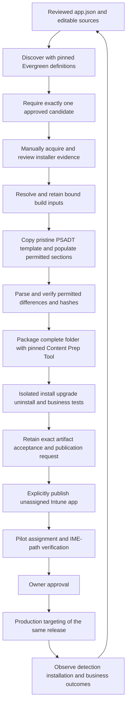

# Manual Intune application lifecycle with Evergreen and PSADT

Research baseline: November 3, 2026, America/Los_Angeles. Audience: the engineer owning application packaging and the Intune administrator approving deployments. The initial scope is Windows 11 x64, machine-wide applications installed as SYSTEM, with centrally controlled updates where vendors support them. The Microsoft cloud is not yet confirmed; global commercial endpoints are an assumption, not a verified tenant property.

The current v3 configuration workflow uses one authored `app.json` and editable action/detection sources per application. It retains native-v2 endpoint behavior: native PSADT process handling with `DeployMode Auto`, separate Intune management of Firefox policy, no custom deployment downgrade guard, and the named profile's stock completion-prompt omission. See the [native sample review](Native-PSADT-review.md) for the historical corrections and [walkthrough](Getting-started.md) for current commands. Earlier validation evidence remains historical and is not evidence for changed scripts.

## 1 Executive recommendation

Use the small Windows-based toolset to produce a retained, reviewed release artifact. Evergreen discovers candidates; the v3 application definition supplies selection and validation policy; the resolver checks local installer evidence and binds the release; the builder populates the official PSADT 4.1.8 v4 template. IntuneWin32App supports separate packaging and publication operations. Keep discovery, resolution, build, validation, publication and targeting separate. A successful upload is only a content-management outcome; installation and application functionality require independent evidence.

The local orchestration contract supports 64-bit Windows PowerShell 5.1 and PowerShell 7.5+. Windows PowerShell additionally requires installed `pwsh.exe` 7.5+ for JSON Schema validation; retained records use the shared JSON reader/writer to preserve strings across runtimes. Passing offline checks does not validate every real module/runtime execution path. The endpoint carries PSADT inside each package and does not need Evergreen, IntuneWin32App, the Content Prep Tool, or a globally installed PSADT module. PSADT's tagged prerequisites include PowerShell 5.1 and .NET Framework 4.7.2; the Windows packaging utility also depends on .NET Framework. [PSADT prerequisites](https://github.com/PSAppDeployToolkit/PSAppDeployToolkit/blob/4.1.8/README.md), [Content Prep Tool](https://github.com/microsoft/Microsoft-Win32-Content-Prep-Tool)

Pin four independent inputs: the Evergreen module, Evergreen application definitions, the PSADT release archive, and the Microsoft packaging executable. Pin IntuneWin32App separately for packaging/publication. Retain dependency hashes, definition provenance and generator implementation hashes in build records. A matching module manifest version does not prove that GitHub's current code matches a published package.

Use a new Intune application for each approved release. Publish it without assignments, pilot that exact artifact, then add production targeting after approval. This gives a straightforward release boundary for a new capability. Content replacement on a stable application ID is an exception requiring its own migration and rollback procedure.

Keep 4.1.8 as the initial reproducible baseline. Review future toolkit releases deliberately; freezing indefinitely accumulates security and compatibility risk. Do not adopt either candidate factory wholesale at this stage. Their reusable ideas do not remove the need to migrate and verify their actual toolkit layouts. See [framework assessment](Framework-assessment.md).

**Verification labels used throughout:** verified means inspected source or recorded local validation; recommended means an engineering choice for this scope; assumed means an environmental input still needed; untested means the behavior has not been exercised on endpoints or in Intune. The [validation record](../evidence/configuration-v3-validation.md) states precisely which checks ran.

## 2 Capability and gap matrix

| Responsibility | Evergreen | PSADT 4.1.8 | IntuneWin32App 1.5.0 | Required orchestration or human work |
|---|---|---|---|---|
| Discover releases | Application-specific API/site adapters and metadata | None | Lists existing Intune objects, not vendor releases | Select approved channel/edition; resolve ambiguous output |
| Download installers | Discovery URLs and download helper | Can run application commands but is not the release-discovery system | Uploads prepared content | Enforce URL, identity, signature and hash policy; detect incomplete downloads |
| Prepare deployment | No standard endpoint deployment template | Official v4 template, application functions, process/MSI helpers, UI and logs | No application-specific installation logic | Populate only approved template fields/sections; validate vendor arguments |
| Package content | None | Supplies complete deployment folder and launcher | Wraps Microsoft's Content Prep Tool | Pin the utility; exclude output/secrets from source; verify resulting artifact |
| Configure/publish | None | None | Creates app metadata, content versions and uploads | Explicit detection/requirements; deduplication, journal and recovery |
| Assign/update lifecycle | None | Executes requested action on the device | Assignment, dependency, supersedence and content-update commands | Pilot approval, reconciliation, retention and supported downgrade decisions |
| Prove operational success | No | Process results and logs | Graph object/report access is not functional acceptance | Endpoint detection, installation tests, business tests and owner sign-off |

Evergreen's published `2610.2859.0` downloader must not be treated as a complete integrity gate. Archive inspection found that newer checksum/retry options are absent from this release. Keep checksum/publisher checks outside the helper, and treat any returned path as untrusted until verified. Its separately cached application definitions also execute PowerShell and belong in the trusted dependency inventory. [Published module](https://www.powershellgallery.com/packages/Evergreen/2610.2859.0), [definition release](https://github.com/EUCPilots/evergreen-apps/releases/tag/v26.11.03.146), [download evidence](../evidence/source-ledger.md)

PSADT supplies application execution and logging; it does not choose a business-approved release, prove installer authenticity, generate a reliable detection policy for every app, or manage pilot success. IntuneWin32App offers operations, not a transactional application factory. See its [published package](https://www.powershellgallery.com/packages/IntuneWin32App/1.5.0) and [operation analysis](Intune-operations.md).

## 3 End-to-end architecture



The definition is engineer-authored intent; installation arguments remain exclusively in editable action scripts. Discovery returns selected metadata and source evidence, not permission to deploy. Resolution checks the acquired bytes and reviewed evidence, then binds deployment metadata and standalone detection to that release. Building produces a complete deployment directory and manifest. Packaging produces `.intunewin`; it does not install the app. Endpoint and owner evidence is tied to the exact package/detection hashes before publication preparation can report ready. Publication creates a Graph object and uploads content. Assignment authorizes distribution. Promotion changes targets and preserves the tested artifact.

### MSI files inside a PSADT package

Select `Invoke-AppDeployToolkit.exe` as the setup file. Set explicit Intune commands:

```text
Invoke-AppDeployToolkit.exe -DeploymentType Install -DeployMode Auto
Invoke-AppDeployToolkit.exe -DeploymentType Uninstall -DeployMode Auto
```

This package follows IntuneWin32App's explicit-command EXE path even when `Files` contains an MSI. Do not use `.ApplicationInfo.MsiInfo` from the resulting package as if the selected setup file had been that MSI. Read MSI properties directly from the installer using Windows Installer APIs on the build host, and separately choose detection. Preserve the MSI's vendor, ProductCode, UpgradeCode where available, ProductVersion, language, and summary architecture in evidence. These are useful observations, not proof that the MSI supports every standard action. [Microsoft package preparation](https://learn.microsoft.com/intune/app-management/deployment/create-win32-package), [published Add-IntuneWin32App](https://www.powershellgallery.com/packages/IntuneWin32App/1.5.0/Content/Public%5CAdd-IntuneWin32App.ps1)

MSI exit codes first pass through PSADT's process/session behavior and then the launcher. Configure compatible success/reboot codes at both layers. Do not classify a wrapper's marker-file write as application detection. Firefox demonstrates a second trap: its MSI wraps an EXE and does not support MSI `/x` or `/f`. [Mozilla MSI behavior](https://support.mozilla.org/en-US/kb/deploy-firefox-msi-installers)

## 4 Smallest useful manual implementation

The delivered files include explicit local resolution/build operations and manifest/request consumers, with preview, static and mocked checks. They remain a manual research workflow rather than a production publisher. The authored and release layouts are:

```text
source-controlled repository/
  examples/apps/<app>/  app.json, editable actions, Detect.template.ps1
  scripts/              small operation entry points and build-only helpers
  examples/             discovery, packaging and publication entry points
  schemas/              application, evidence and artifact contracts
  tests/                offline checks and endpoint procedures
  docs/                 standards and operational decisions

C:\IntuneLifecycle/releases/<app>/<attempt>/
  Application/          reviewed app.json and editable source copy
  Payload/              manually acquired installer
  Evidence/             discovery, installer and release acceptance records
  resolved-build.json   retained resolved input record
  Build/                input snapshots, Source, Detect.ps1, build manifest
  Package/              intunewin and package-manifest.json
  publication-request.json
```

The repository currently resides in OneDrive. Active locks and operational artifacts belong on a local nonsynchronized NTFS volume. Build and packaging use fresh destinations; retained records are written atomically. A durable per-application/tenant state store, append-only mutation journal, shared ownership and reconciliation service remain roadmap work. Synchronization conflicts can defeat atomic-file or ownership assumptions. Later, use a suitable shared artifact store when multiple operators need it; a cloud service is not necessary for one operator.

### Operation contracts

| Operation | Input | Output | Permitted effects |
|---|---|---|---|
| Discover | V3 definition, module/definition pins | One selected `DiscoveredRelease` or rejection | Vendor reads and optional local record write; no installer download or Intune access |
| Resolve | Definition, retained release, local installer and installer evidence | Hash-bound `ResolvedBuild` | Read-only; caller saves the record explicitly |
| Build | Resolved record and pristine template | Source/detection, input snapshots and `ApplicationBuild` manifest | Preview by default; explicit local staging never executes deployment code |
| Package | Complete build manifest and pinned module/tool | `.intunewin` and `ApplicationPackage` manifest | Preview by default; explicit local Content Prep execution |
| Validate | Exact build/package/detection and test profile | Static results and separate endpoint/business/prerequisite acceptance | Endpoint tests require explicitly selected isolated machines and human review |
| Prepare publication | Package manifest, optional acceptance and signed detection | Hash-bound `PublicationRequest`, readiness and missing evidence | Read-only local preparation; caller saves the record explicitly |
| Publish | Ready request and explicit tenant settings | App/content result requiring retained state and reconciliation | Tenant mutation; default preview cannot authenticate or invoke writer commands; durable journaling remains future work |
| Assign | Verified app ID, explicit group IDs/intents and approval record | Assignment IDs and reconciled target state | Separate tenant mutation, never implicit in Publish |
| Reconcile (roadmap) | Tenant/app identity and journal | Difference report and recovery proposal | Proposed read-only operation; current operators reconcile manually before explicit repairs |

Avoid hidden module updates, "latest" toolkit resolution, implicit group-name lookup, and implicit production targeting. Configuration contains identifiers and policies; credentials come from the user's interactive session or protected certificate store at execution time. Log phase, run/build/app IDs, operation outcome, duration and sanitized error details. Do not log bearer tokens, client secrets, SAS upload URLs, or signed download-query credentials.

The offline preview should construct and validate the proposed object without importing publishing code or acquiring tokens. A distinct optional tenant-read operation can reconcile with read-only permissions. `-WhatIf` on the module is not the safety mechanism. [Published implementation analysis](Intune-operations.md)

## 5 Application schema and provenance

Use the [version 3 application schema](../schemas/application-definition.v3.schema.json), [Firefox definition](../examples/apps/firefox/app.json), [Notepad++ definition](../examples/apps/notepadplusplus/app.json) and [field reference](Configuration-reference.md). Each application has one authored `app.json`, separate action scripts and `Detect.template.ps1`; the builder generates metadata/action-map inputs. JSON contains data and constrained selections, not executable command strings. The contract retains `template-default` deferrals, a 120-minute Intune limit, external policy prerequisites and `vendor-default` downgrade handling. Those policy declarations do not create assignments, deploy policies or guarantee supported downgrade behavior. V2 inputs are rejected with migration guidance; archived fixtures preserve their historical tests.

| Value category | Origin and handling |
|---|---|
| Stable application ID, owner, revision, display metadata | Engineer. Keep the stable ID independent of display name, version, target group and filename. |
| Channel, edition, language, architecture, install type, update policy | Engineer selects supported values; discovery must prove the selection matches. A missing discovery property is not a match. |
| Candidate version, URI, vendor checksum when available | Evergreen output. Retain the selected release, restricted source metadata and dependency pins; validate before use. The package filename is an authored controlled alias. |
| Authenticode status/signer, MSI properties, PE architecture, local SHA256 | Downloaded bytes and local inspection. Compare with approved identity, do not merely copy into a manifest. |
| Toolkit profile/revision, deployment actions, process/deferral policy, detection/requirements | Engineer-reviewed definition and sources. Sample application sections contain native PSADT calls and simple assignments/interpolation. Dependency relationships remain separate tenant work. |
| Build ID, normalized filenames, package hash, command lines, validation results | Build-generated. Derive deterministically from accepted inputs where practical. |
| App/content/assignment IDs, tenant, upload results | Publication-generated and reconciled with Intune; never guessed from names. |

Version comparison is per application. The implemented detection binder accepts canonical numeric versions with two to four components and binds one reviewed top-level version literal. Other formats such as `2026 R2` or `1.0-beta` require a separate mapping and acceptance change; they are not silently cast. A version increase is not itself enough to establish a supported upgrade path.

The retained record chain connects installer/support/source hashes, discovery selection, validation policy/evidence, dependency pins, generator hashes, staged inventory, package bytes and acceptance evidence. Discovery selection and build inputs have distinct identities; the publication request separately seals effective settings and artifact references. Rollout-only edits do not create a different package identity. The [older illustrative manifest](../examples/build-manifest.example.json) is historical, not an input to the v3 build. Current record shapes and commands are described in the [configuration reference](Configuration-reference.md) and [walkthrough](Getting-started.md). Acquisition timestamps stay outside the deterministic build identity. Package encryption or timestamps may make repeated `.intunewin` bytes differ even with identical inputs; reuse an accepted artifact instead of promising byte-identical rebuilds.

## 6 PSADT 4.1.8 packaging standard

The complete [PSADT standard](PSADT-4.1.8-standard.md) specifies the verified archive, exact file inventory, fields, action sections, adapter, and validation. Preserve the whole released template. `Files` holds installers, transforms, patches and any bundled prerequisite payloads. `SupportFiles` holds application configuration. The bundled `PSAppDeployToolkit` module and launcher binaries remain byte-for-byte unchanged.

Populate only approved `$adtSession` metadata and designated Pre/Main/Post application tasks in `Install-ADTDeployment`, `Uninstall-ADTDeployment`, and `Repair-ADTDeployment`. The named `official-4.1.8-native-v2` profile also uses the adapter's narrow opt-in omission of the stock illustrative completion prompt. The adapter default retains that prompt; current v3 outputs preserve the compatibility profile and do not establish strict stock-prompt preservation. Initialization, module import, dispatch, catch blocks, session closing, native welcome calls, root configuration and extension files remain intact. The local adapter validates template identity, locates metadata using the PowerShell AST, inserts reviewed snippets at verified comment locations, serializes literals safely, and proves unchanged bytes outside allowed edits.

For the requested profile, use `Auto` and populate `AppProcessesToClose` with `firefox` or `notepad++`, without `.exe`. Native session initialization selects Silent when none of the configured processes are running; otherwise it becomes Interactive when a suitable session is available. OOBE, detected active user ESP, or SYSTEM/session 0 without a suitable interactive user can select Silent first. An empty process list does not provide the requested process-dependent selection. The frontend's help reverses parts of this condition; use the tagged implementation. Do not include ServiceUI. Microsoft's supported Intune model remains silent installation; native PSADT UI does not change that support boundary. [Auto implementation](https://github.com/PSAppDeployToolkit/PSAppDeployToolkit/blob/4.1.8/src/PSADT/PSADT/Module/DeploymentSession.cs#L675-L838), [Microsoft support boundary](https://learn.microsoft.com/intune/app-management/deployment/win32)

The samples preserve the native welcome defaults: installation permits three deferrals with disk-space checking and a persistent prompt; uninstall uses a 60-second process-close countdown. Auto is chosen during session initialization, not continuously. Silent fallback or an application started after the initial check can result in native forced closure; the defaults do not enable process execution blocking or a save-work guarantee. There is no custom process polling or synthetic busy-app `1618` path. Keep native deferral timing and configure Intune for 120 minutes total because the stock prompt timeout is 3,300 seconds (55 minutes). An Intune deadline does not set a PSADT deferral deadline. [Welcome implementation](https://github.com/PSAppDeployToolkit/PSAppDeployToolkit/blob/4.1.8/src/PSAppDeployToolkit/Public/Show-ADTInstallationWelcome.ps1), [configuration](https://github.com/PSAppDeployToolkit/PSAppDeployToolkit/blob/4.1.8/src/PSAppDeployToolkit/Config/config.psd1)

Default PSADT deferral is `1602`, prompt timeout is `1618`, and the template may convert a terminating application exception into `60001`. `Start-ADTProcess` and `Start-ADTMsiProcess` support `-ExitOnProcessFailure` when native installer failure propagation is desired. Do not use v3's `-AllowRebootPassThru`; the 4.1.8 script exposes `-SuppressRebootPassThru`, which the normal command omits. [Tagged config](https://github.com/PSAppDeployToolkit/PSAppDeployToolkit/blob/4.1.8/src/PSAppDeployToolkit/Config/config.psd1), [tagged process implementation](https://github.com/PSAppDeployToolkit/PSAppDeployToolkit/blob/4.1.8/src/PSAppDeployToolkit/Public/Start-ADTProcess.ps1)

The selected module starts with `0` and `1707` success, `3010` soft reboot, `1641` hard reboot and `1618` retry. Its Add/Set `-ReturnCode` arguments append extra entries; they do not replace that list. The revised publisher adds `1602` retry and `60001`, `60008`, `69001` failed; it does not duplicate the built-in entries. Never map deferral to success. PSADT's accepted-success list is separate. Intune's retry classification attempts installation three times with five-minute waits; required-app reevaluation is a separate approximately daily cycle. These retries can consume the three native deferrals quickly; they are not three days. [Published module analysis](Intune-operations.md), [Microsoft return-code and detection behavior](https://learn.microsoft.com/intune/app-management/deployment/add-win32)

Suppress installer-initiated restarts where supported and let the agreed Intune policy manage reboot notification/timing. A multi-installer package cannot assume an early `3010` survives a later `0`; aggregate results through a verified application-section design, or model prerequisites as separately detected Intune dependencies. Prefer the latter initially when appropriate. A prerequisite dependency does not automatically uninstall with its parent.

Retain PSADT and native installer logs, link them with the release/build identifier, and collect IME logs for deployment investigation. Preserve user data during uninstall unless the reviewed application design explicitly includes approved cleanup. Repeated registry/file configuration actions must converge on the intended state; avoid broad deletion and restore only values the package owns.

Organization signing remains a separate concern where required. Publication preparation supports a separate signed detection copy, verifying its unchanged unsigned body and retaining the final artifact hash. The implemented build inventory does not permit signing the generated deployment script in place; a deployment-source signing stage needs a separately reviewed design before use in a mandatory-signing environment. Validate trusted publisher chains on endpoints and keep private keys outside build artifacts. Do not silently re-sign or modify upstream framework binaries.

## 7 Worked MSI and EXE examples

The [worked examples](Worked-examples.md) connect the current application definitions to source-verified commands, generated metadata and independent detection. Firefox illustrates a real MSI-shaped bootstrapper; Notepad++ illustrates an EXE with its own update-policy tradeoff.

For Firefox, the verified Evergreen definition uses channel `Current`, language `en-US`, architecture `x64`, and type `msi`. Require exactly one candidate. Install using PSADT's MSI helper with supported properties. Uninstall using the vendor's `uninstall\helper.exe /S`, not an assumed MSI ProductCode. Repair is unsupported in this example rather than represented as an empty success. Detect the actual Firefox installation and acceptable version independently. [Definition](https://github.com/EUCPilots/evergreen-apps/blob/v26.11.03.146/Apps/Get-MozillaFirefox.ps1), [vendor uninstall](https://support.mozilla.org/en-US/kb/silently-install-uninstall-firefox-enterprise)

For Notepad++, restrict the candidate to the x64 EXE installer rather than a portable archive. Do not filter on invented Channel or Language properties that its definition does not emit. The vendor's case-sensitive `/S /noUpdater` switches provide silent deployment without the normal updating components; `/noUpdater` also affects PluginsAdmin/WinGUP, so application ownership must accept that consequence. Avoid installer options that launch the editor as SYSTEM after installation. [Definition](https://github.com/EUCPilots/evergreen-apps/blob/v26.11.03.146/Apps/Get-NotepadPlusPlus.ps1), [vendor arguments](https://github.com/notepad-plus-plus/npp-usermanual/blob/master/content/docs/command-prompt.md)

Current offline v3 reference outputs use the ignored `generated-examples/psadt-4.1.8-config-v3/` location. Historical `psadt-4.1.8-auto-v2/` copies and their original hashes remain separate evidence. Offline fixtures contain test payloads, not approved installers, and cannot be published. The two applications retain Main-only native runners without custom Pre/Post checks. A missing uninstaller uses the native failure path; manual uninstall of an absent app is not promised to succeed. Repair remains unsupported and returns `69001` after the unchanged stock welcome, which can prompt or close processes.

The examples are illustrative and locally checked to the extent recorded. They have not been certified against fresh/upgrade/uninstall endpoint scenarios. Publisher identity and actual current installer contents still require validation before operational use.

## 8 Detection and applicability

| Mechanism | Suitable use | Important limits |
|---|---|---|
| MSI product code/version | A genuine installed MSI product with reliable registration | ProductCode may change across major releases; a bootstrapper MSI may not register the installed app as expected. Exact old-code detection may repeatedly attempt installation on a newer version. |
| File version | Stable main executable with meaningful version metadata | File presence alone is weak; path, architecture, channel and version format require validation. A leftover binary is not proof every component works. |
| Registry | Reliable vendor/ARP values identifying context, channel and version | Read the correct 32/64-bit view; values can remain after failure. SYSTEM HKCU is unsuitable for arbitrary signed-in users. |
| Script | Multiple components, product-code families, version normalization, custom identity | Keep it small, deterministic, offline and independent of PSADT. Test positive, negative and error outcomes. |

For script detection, return exit `0` plus nonempty STDOUT only when the application is installed at an acceptable version; STDERR causes failure even with `0` and STDOUT. Return nonzero without success output for not-installed/error. Prefer UTF-8 BOM for Windows PowerShell scripts. Multiple manual detection rules are ANDed. Detection should not download modules, import the PSADT copy from an IME cache, or depend on a prior wrapper marker. [Intune detection contract](https://learn.microsoft.com/intune/app-management/deployment/add-win32#step-4-detection-rules)

The standalone sample detection retains installed-version `>=` target. `Detect.template.ps1` is authored source; resolution and build bind its target to the same accepted release used for deployment metadata and publication. Intune can detect an acceptable newer installation and skip deployment; the generated deployment has no downgrade guard. A direct manual execution follows vendor behavior and does not establish downgrade support. Superseded old applications can remain detected; manage old assignments and avoid uninstalling an older wrapper whose vendor uninstaller would remove a newer shared installation.

A deployment's requirement rule answers whether installation is applicable; detection answers whether its desired state is already present. For update-only deployments, require an existing matching application family/architecture/channel in an approved version range, then use target-version detection independently. Fresh-install deployments omit the existing-install requirement. Supersedence alone is not a universal update-only filter. [Supersedence behavior](https://learn.microsoft.com/intune/app-management/deployment/configure-win32-supersedence)

Evaluate detection on clean, older, exact, newer, wrong-architecture, wrong-language/channel, partial-install, and post-uninstall machines. Configuration requirements should only be part of detection when missing configuration truly means the application deployment is incomplete; otherwise a policy change can cause unnecessary reinstalls. Multi-component apps require all essential components, not merely the first executable.

## 9 Repeatability and operational state

The implementation persists separate application and content-derived build identities in local records, source snapshots and package/publication requests. The remaining operational state design must connect those records with tenant/app/content IDs, assignments, last reconciled state and timestamps. Atomic local records and fresh destination locks are not a durable cross-operation or cross-tenant state machine.

The future state service should use explicit states such as `Discovered`, `DownloadedValidated`, `Built`, `LocallyValidated`, `CreatedUnassigned`, `ContentCommitted`, `PublishedUnassigned`, `PilotAssigned`, `PilotAccepted`, `ProductionAssigned`, `Retired`, and `Failed`. These are proposed orchestration states. Device observations remain timestamped records with denominators, not a single global `Deployed=true` flag.

| Condition | Required behavior |
|---|---|
| Same version and same accepted input hashes | Reuse the validated artifact; reconcile publication instead of rebuilding or duplicating. |
| Same version with a changed installer hash | Treat as a new candidate; quarantine/review the change and create a distinct build identity. Do not silently overwrite the old payload. |
| Effective build setting, snippet, detection or PSADT template changes | New build identity and relevant regression tests even when application version is unchanged; rollout-only changes retain the build identity. |
| Download failure | Keep temporary content out of the accepted cache; verify length/type/hash/identity before atomic acceptance. |
| Create/upload response lost | Journal the operation; search and reconcile by the recorded stable marker and app ID before retrying a POST. Never resolve duplicates solely by display name. |
| Partial upload/app creation | Keep the app unassigned; inspect content/version state and resume only supported operations or explicitly retire the incomplete object. |
| Token expiry, throttling, transient network errors | Bounded retries with Retry-After/backoff and fresh authentication as required; distinguish safe reads from potentially completed writes. |
| Concurrent run | Acquire an exclusive per-app/build lock and journal ownership. Single-host locking does not coordinate two independent hosts. |
| Local state differs from Intune | Produce a reconciliation report; do not silently erase administrator changes or recreate assignments. |

Write state to a temporary file on the same local volume, flush it, and replace atomically; keep recoverable previous generations. Journal mutation intent before the request and the observed result afterward. This narrows uncertainty but cannot make Graph and a local JSON file one transaction. Use a managed marker containing stable application/build identity in supported app metadata, then retain the canonical app ID locally. Strip secrets from journal payloads.

Preserve immutable previous artifacts and their source/test evidence. A sensible initial retention recommendation is the active release plus two previous accepted releases and every version still referenced by assignments, dependencies, supersedence or ESP. Do not automate deletion until dependency/reference reconciliation is implemented. Installer redistribution and vendor retention rights still apply.

## 10 Updates authentication and recovery

The [Intune operations guide](Intune-operations.md) compares per-release apps and stable-ID content updates across app IDs, assignments, detection, Company Portal, dependencies, supersedence, ESP, cleanup and recovery. It also provides separate publication/assignment illustrations and operation-specific permissions.

New-app-per-release makes pilot and production separation easier: the old production app remains unchanged while the new app is tested. Before promotion, resolve conflicting required/uninstall assignments and old supersedence relationships deliberately. A stable-ID content update affects every assignment on that ID; it cannot inherently keep one group on old content. Replacing content, changing metadata/detection, and committing assignments are separate operations, not an atomic release transaction.

For centrally controlled updates, disable vendor updating only through supported policy and accept responsibility for timely security releases. Record exceptions when the vendor updater is necessary or cannot be disabled reliably. Detection should tolerate supported newer versions where appropriate, and unexpected self-updates should trigger review rather than an automatic downgrade loop.

Firefox's `DisableAppUpdate` policy is an external Intune configuration prerequisite, with policy identity and enforcement evidence still pending. The package does not write registry policy or stage, merge, overwrite or remove `policies.json`; the MSI retains `REMOVE_DISTRIBUTION_DIR=false` to preserve existing distribution content. Validate the effective policy independently, including machines already detected at the current/newer version. [Mozilla policy reference](https://firefox-admin-docs.mozilla.org/reference/policies/disableappupdate/)

Notepad++ still receives `/noUpdater` when its installation runs. Existing current/newer installations can satisfy detection without running the installer, and legacy updater components need an approved migration and endpoint acceptance. The deployment no longer includes a custom post-install updater check or deletion. A retained updater is a failed acceptance case, not permission to publish an unvalidated upgrade path. Do not conflate application-version detection with central-update-policy compliance.

Rollback starts by stopping further distribution, assessing affected devices, and selecting a vendor-supported remedy. Removing an assignment does not uninstall software or recall an already cached installation. Recovery may mean a forward fix, reinstall, explicitly supported downgrade, or uninstall/reinstall with data migration. A retained old package supplies bytes; it does not guarantee compatible user data, settings or installer downgrade behavior.

Use an organization-owned app registration for interactive delegated authentication, with the required tenant consent and Intune RBAC. For later unattended operation, prefer a certificate with a protected nonexportable private key where feasible; restrict access to the service identity and monitor expiry. Keep secrets outside definitions and records. The current publisher requires confirmed commercial-cloud compatibility; sovereign-cloud support needs a separate design because the inspected authentication surface has no cloud-selection parameter. [Published authentication function](https://www.powershellgallery.com/packages/IntuneWin32App/1.5.0/Content/Public%5CConnect-MSIntuneGraph.ps1)

## 11 Testing and operational readiness

| Test area | Build host checks | Isolated Windows or future pilot evidence |
|---|---|---|
| Installer identity | Automated source/hash/signature policy checks plus human MSI/PE identity and incomplete/unexpected-content review | Vendor payload installs the intended product/edition/language |
| Template | Pinned archive/file hashes, metadata and action validation, parser errors, approved differences, pristine invariance | Exact launcher and deployment commands under IME-like SYSTEM context |
| Install and upgrade | Source-verified native arguments and command conformance; independent detection version fixtures | Clean install; each supported predecessor; exact/newer installed versions; vendor behavior on direct execution; upgrade data preservation |
| Detection and applicability | Missing/error/positive fixtures; architecture and version parsing | Before/after install, after uninstall, wrong variants, update-only clean-machine exclusion |
| Uninstall and repair | Explicit vendor-supported actions; unsupported repair fails clearly | Product removed, expected retained user data, repeat uninstall behavior, supported repair restores state |
| UI and process policy | Auto commands/process metadata; 120-minute timeout; 1602/1618 retry mappings; placeholder prompt omitted | Running/closed app; no user; OOBE/ESP; locked desktop; three deferrals/exhaustion; prompt timeout; uninstall countdown; app starts after mode selection or relaunches |
| Reboots and failures | Return-code mapping consistency, no waitless installer paths | 3010/1641/1618; interrupted installation; partial changes; dependency failure; no false success |
| Publication and assignment | Frozen request/evidence checks, schema and mocked preview/execution isolation; durable journal/recovery tests remain roadmap work | Future tenant test: no duplicate app after uncertain response; no assignment during publication; correct exclusions |
| Business acceptance | Named owner and written critical workflows | Launch, licensing, plugins, document/data compatibility, authentication and business workflows |
| External configuration | Firefox policy requirement remains pending; no packaged policy writer | Effective Firefox update policy; Notepad++ updater/Plugins Admin consequences and legacy-updater migration |

Capture OS build, application versions, initial state, exact command, execution context, exit code, logs, detection output, reboot status, and reviewer for every endpoint case. Use VM snapshots or disposable machines. Do not run installation tests on the packaging workstation. Test the launcher from the actual intended process context; launching it under PowerShell 7 can differ from Windows PowerShell/IME behavior.

Recommended phase-3 promotion criteria are at least five representative reachable pilot devices (or all devices if the estate is smaller), at least one supported upgrade and one fresh-install case, three business days of observation, every critical business test passing, and no unresolved deployment failure or severe regression on those pilot devices. These are proposed starting thresholds, not measured outcomes. Define exclusions and denominators so offline devices cannot silently inflate success. An emergency release may use a shorter documented pilot with an owner-approved exception and active monitoring.

Collect PSADT/native-installer logs alongside IME logs. Microsoft documents IME logs under `C:\ProgramData\Microsoft\IntuneManagementExtension\Logs`; `AppWorkload.log` and `AppActionProcessor.log` help distinguish applicability/detection from installation. Keep personal data out of routine centralized logging and grant support access deliberately. [Microsoft troubleshooting](https://learn.microsoft.com/intune/app-management/deployment/troubleshoot-win32)

## 12 Maintenance and phased roadmap

| Phase | Deliverables and prerequisites | Acceptance criteria | Operational owner and deferred work |
|---|---|---|---|
| 1 Manual preparation | Delivered v3 definitions, resolver/build/manifest operations, pristine adapter and offline tests; approved real installers, Windows host and isolated VMs still required | Every static check passes; all applicable clean/upgrade/uninstall/detection cases have evidence; package source contains no credentials; application owner accepts critical functions | Packaging engineer and application owner. Real packaging/acceptance gates still need evidence. |
| 2 Unassigned publication | Confirmed cloud, tenant settings, consent/RBAC, journal, explicit metadata/detection and read-only reconciliation | One approved release creates one unassigned app; repeat and interrupted runs reconcile without duplicates; content is committed and assignments remain empty | Intune administrator. Assignments and automated cleanup wait. |
| 3 Controlled rollout | Pilot/prod IDs, explicit intents/exclusions, upgrade applicability, supersedence/reference inventory, approval and recovery procedure | Pilot thresholds and business tests pass; production uses the same package hash; an owner approves; recovery tabletop identifies action and responsible person | Intune administrator and application owner. Unattended promotion waits. |
| 4 Scheduled execution | Protected certificate, one-host scheduling, nonoverlapping runs, monitoring, exception queue, backup/retention | Three consecutive scheduled cycles avoid duplicates; injected API/download/expiry failures produce actionable alerts; credential rotation is exercised | Automation owner. A CI/CD platform remains optional. |
| 5 CI/CD migration | Chosen platform, isolated Windows runner, artifact transfer, protected publishing identity and approval gates | Pipeline uses the same definition/operation contracts; build jobs have no tenant-write access; publish/promote are auditable; prior artifacts remain usable | Platform and Intune owners. No new framework solely for pipeline adoption. |

Review failed discovery/downloads on each run, security releases through the organization's patch policy, and dependency/toolkit changes on a regular engineering cadence. A vendor API change should fail selection or validation visibly, not fall back to a different edition or architecture. Authenticated downloads require a separately designed provider/credential policy; unsupported applications can use an engineer-supplied verified payload through the same downstream artifact contract.

Evergreen definition updates are code changes: inspect release differences and test representative app output before updating the isolated definition cache. Never update the cache midway through a build. Review Graph beta dependencies when upgrading IntuneWin32App and retain a test tenant/release checklist for future lifecycle validation. Keep module upgrades separate from application rollouts so failures have a clear cause.

For a PSADT upgrade, review release notes and API/template changes; download and verify a new pristine archive; implement a separate version adapter; compare permitted fields, session semantics, UI, exit codes, signatures and runtime requirements; run MSI, EXE, dependency, running-app, no-user, reboot and failure regression cases; adopt in a limited set of new builds; then widen adoption. Retain the old adapter/artifacts for traceability.

Apply a template upgrade to future releases by default. Rebuild existing application versions when it addresses a security issue, prevents an observed deployment failure, or is required for a supported platform change. Such rebuilds get new build IDs and testing; updating the pristine dependency alone must not mutate previously accepted artifacts.

The choices that simplify a later pipeline are explicit inputs/outputs, immutable artifacts, typed configuration, isolated operations, no hidden prompts in automation paths, separate credentials, stable identity, local tests, deterministic build keys, and explicit approvals. The pipeline should supply execution and storage, not redefine application behavior.

## 13 Environment questions and source index

The research can be used now, but future deployment requires answers to these specific questions:

1. Is the tenant global commercial, US government, or China? Which app-registration, consent, Conditional Access and Intune RBAC restrictions apply?
2. Which applications and predecessor versions are supported? Who accepts functionality and owns urgent updates when self-updaters are disabled?
3. What are the pilot/production group IDs, intended assignment types, exclusions, observation period and exception authority?
4. Are signed scripts mandatory, and what WDAC/AppLocker, PowerShell language-mode, proxy, TLS-inspection and download restrictions apply?
5. Where should immutable artifacts and nonsynchronized state live, who can write them, and what retention/backup policy applies?
6. Are ARM64, per-user, multi-session or non-English profiles required later? The requested Auto profile already needs representative interactive and no-user acceptance.
7. What app IDs are referenced by ESP, dependencies or supersedence when existing apps are eventually migrated?

The [source ledger](../evidence/source-ledger.md) records published releases, repository commits, primary Microsoft/vendor documentation and the associated local verification evidence. Detailed references appear beside the behavior they support in this report and its companion guides.

The thirteen requested outputs remain covered by sections 1–13 and the linked schema, examples, packaging standard, operations guide, framework assessment and evidence. V3 adds a locally implemented configuration-to-artifact path and frozen publication requests; it does not complete the operational roadmap or prove real packaging, installation, Intune upload, assignment or business acceptance. The [validation record](../evidence/configuration-v3-validation.md) separates current offline evidence from historical observations.
